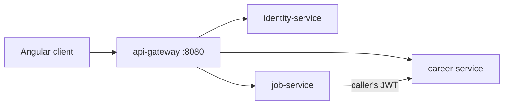

# Career-Twin

> **Personal Engineering Project** · work in progress (MVP slice) · no real users, no production deployment

A career-intelligence platform that builds a *twin* of your skills from **evidence** (projects,
experience, certifications...) and tells you, with an explainable score, how ready you are for a
target role or a specific job posting, what is missing, and what to do next.

The design rule: **scores are computed by a deterministic engine, never generated by an AI.**
Every number can be traced back to the evidence behind it.

This is a rewrite of an earlier single-file React prototype into a microservices system
(Spring Boot + Angular), using the same stack as my
[fintech-wallet-engine](https://github.com/Souhajaidi1/fintech-wallet-engine).

## Architecture



Java 21 · Spring Boot 3.3 · Spring Security (stateless JWT, RS256) · Spring Cloud Gateway ·
PostgreSQL 16 + Flyway (database per service) · Angular (standalone components, signals) ·
Docker Compose · GitHub Actions. Details in [docs/architecture.md](docs/architecture.md) and the
[ADRs](docs/adr).

## Status — read this first

| Area | State |
|---|---|
| `career-engine` (scoring: skill levels, readiness, gaps, job match, what-if, roadmap) | Implemented, unit-tested |
| `security-lib`, `identity-service` (register/login, RS256 tokens) | Implemented |
| `career-service` (profile, evidence, goals, catalog, analysis) | Implemented |
| `job-service` (save postings, match against your evidence) | Implemented |
| `api-gateway`, Angular client, Docker Compose, CI | Implemented |
| Assessments, mock interviews, application tracker, analytics, market insights, AI coach | **Not ported yet** (existed in the prototype) |

**Not yet verified end to end.** The code was written in an environment without access to Maven
Central or Docker, so `mvn verify`, the Testcontainers integration tests and `docker compose up`
had **not been run** when this was pushed. The scoring invariants were checked with a plain-Java
harness and the Angular production build passes. Treat the first CI run as the real test; expect
some fixes. This section will be updated once CI is green.

## Run it

```bash
cp .env.example .env
./scripts/generate-keys.sh >> .env     # RS256 key pair; the private key goes only to identity-service
docker compose up --build              # UI on http://localhost:4200
```

Tests: `mvn verify` (integration tests need Docker). Frontend: `cd frontend && npm ci && npm run build`.

## How scoring works

- Evidence types carry capped point values (experience, project, certification, education,
  repository, assessment, interview, self-reported claim). A claim is worth less than a built
  project; an assessment is worth the most per item.
- Skill level = `100 * (1 - exp(-points / 70))`, capped at 99, with recency weighting, so more
  evidence has diminishing returns.
- Readiness blends coverage, experience fit, evidence depth and practice, scaled by seniority.
- `assessment` and `interview` evidence cannot be created by hand through the API.

The weights are judgement calls, not validated against hiring outcomes. See
[ADR 0003](docs/adr/0003-deterministic-scoring.md).

## Security notes

- Only identity-service holds the private key; all other services verify with the public key.
- The gateway only routes; each service enforces auth itself.
- Resources are owner-scoped: another user's resource looks like a 404.
- No key rotation / JWKS yet.

## Roadmap

1. Get CI green; fix whatever the first real run finds.
2. Port assessments and mock interviews (reserved evidence types).
3. Application tracker and analytics.
4. Optional AI coach for *explanations only*, behind a feature flag.

## Author

Souha Jaidi · [GitHub](https://github.com/Souhajaidi1)
