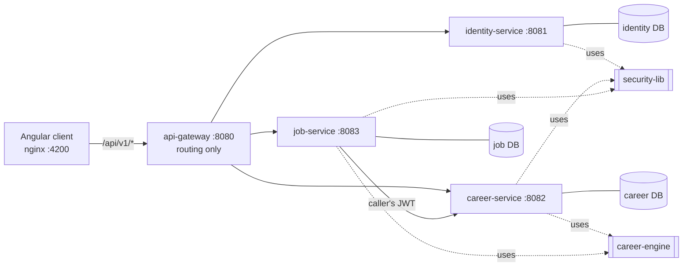

# Architecture

| Module | Responsibility |
|---|---|
| `career-engine` | Pure Java, JDK-only scoring: skill levels, readiness, gaps, job match, what-if, roadmap. No Spring, no I/O. |
| `security-lib` | JWT verification auto-configuration, `CurrentUser`, error model (RFC 7807-style problems). |
| `identity-service` | Registration, login, issues RS256 tokens. Only holder of the private key. |
| `career-service` | Profile, evidence, goals, catalog, analysis (twin, roadmap, simulate). |
| `job-service` | Saved job postings and match against the caller's evidence. |
| `api-gateway` | Single entry point; routes by path. Does **not** authenticate. |
| `frontend` | Angular standalone/signals client. Never computes scores. |

One PostgreSQL server, one database per service; no cross-database access. Services
integrate only over HTTP (job-service -> career-service).

## Request flow: match a job
1. Client calls `POST /api/v1/jobs/{id}/match` with a Bearer token.
2. Gateway routes to job-service, which verifies the JWT locally with the public key.
3. job-service loads the owner's job, parses it, and sends the requirements to career-service
   `POST /api/v1/analysis/match` with the **same token**; career-service scores them against the
   caller's evidence using `ScoringEngine.match`.
4. If career-service is unreachable: lists return `null` scores; a single match returns
   `502 ANALYSIS_UNAVAILABLE`. It never invents a score.

## Honest limits
- Shared libraries couple services at build time (see ADR 0001).
- No distributed tracing, service discovery or message broker; they are not needed at this scale.
